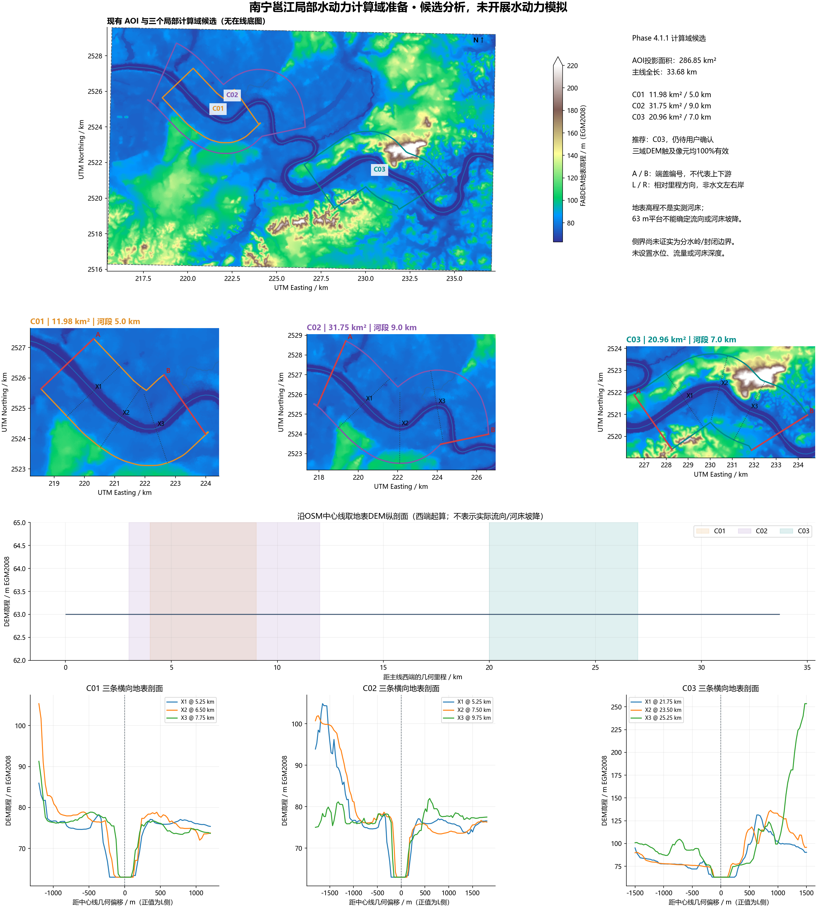

# Phase 4.1.1：水动力计算域候选评审

分析对象：`C:\Users\ly5it\vibecoding\webgis`。生成时间：2026-11-23T23:56:59.759764+08:00。

本阶段完成现有AOI、DEM、河流的只读检查，生成3个局部候选域、6条端边界、9条横剖面及纵剖面。**推荐C03，但尚未选定计算域，等待用户确认；不进入4.1.2。**

## 1. 范围与输入

已阅读AGENTS.md、PROJECT_SPEC.md、TASKS.md、EXISTING_PROJECT_AUDIT.md和INCREMENTAL_UPGRADE_PLAN.md，并检查既有GIS工具。采用现有GDAL/OGR、NumPy、Shapely、Matplotlib，不联网、不安装ANUGA、不修改前端、不设置河床深度或流量。用户要求不覆盖已有文件，因此不更新原有TASKS.md；本报告记录本阶段状态，所有旧Git修改保留。

四个直接输入为 `data/processed/phase2/dem_utm49n_30m.tif`、`aoi_mask.tif`、`rivers_utm49n.gpkg`，以及 `data/study_area/nanning_yongjiang_aoi.geojson`。输入SHA256在JSON中保存并于生成后复核，原始DEM和Phase 2/3处理流程均未重跑。

## 2. 现有研究区与连续性

- AOI为WGS84矩形108.23～108.44°E、22.73～22.85°N；边界加密到0.001°后仅在内存投影。UTM外包范围为215486.435197, 2515902.027337, 237296.829605, 2529584.713342m。
- AOI投影矢量面积286.8489km²；DEM有效像元318,721个，像元面积合计286.8489km²。二者口径不同，不把边缘离散差当数据缺失。
- DEM为EPSG:32649、30m、457×728网格，EGM2008高程；有效像元与AOI掩膜等值，范围内地表高程63.00～288.07m。矩形网格外包范围并不等于全部有效范围。
- 邕江为1条有效、无自交、无相邻重复点的连续LineString，109个节点、长33.6823km。两端位于AOI西、东边界附近，距加密投影AOI边界分别0.000005/0.000001m；按1m几何核对容差，确认主线在两侧穿越AOI边界。精确浮点相交WKT另存JSON，不把投影细小差异当河道缺口。
- 邕江与朝阳溪仍为2个几何连通分量；最小间距347.29m。没有吸附、补线或虚构支流汇入口。主线连续不代表支流水系完整。
- 全主线纵剖面1124个点，其中有效1123、无效1；无效点保留空值，多位于裁剪边界附近，不能将NoData当0m或补成河床。候选域及其纵横端界全部位于有效数据内。

## 3. 候选域构造及比较

为了可复现而规范里程：以邕江几何**西端**为0，沿线累计距离。它是空间索引，**不是上游起点**；未使用OSM原始节点顺序认定流向。各方案沿连续河段构造恒宽平端缓冲走廊，不直接套用整个AOI，也没有根据尚未确定的设计洪水选边界。

| 方案 | 河段长 km | 每侧走廊宽 m | 投影面积 km² | 占AOI | 60m等边三角形粗估数 | 距AOI边界最小值 m |
| --- | ---: | ---: | ---: | ---: | ---: | ---: |
| C01 | 5.00 | 1200 | 11.9837 | 4.18% | 7,688 | 2204 |
| C02 | 9.00 | 1800 | 31.7494 | 11.07% | 20,368 | 804 |
| C03 | 7.00 | 1500 | 20.9579 | 7.31% | 13,445 | 2733 |

面积为多边形投影面积，不是预报淹没面积。三角形数量按面积/(√3/4×边长²)估计，只用于量级比较，实际边界加密、网格质量和混合尺度会改变数量，未生成网格。

### C01：西段紧凑方案

- 选取西端起算几何里程 4.00～9.00 km；单个连续河段。
- EPSG:32649外包范围（西、南、东、北，m）：218567.278922, 2523115.270509, 224085.354018, 2527294.975370。
- WGS84外包范围（西、南、东、北，度）：108.258282, 22.792679, 108.312246, 22.830107。
- 候选域为中心线每侧1200m的平端走廊，覆盖两侧待核实的河岸与洪泛地形；这不是实测河宽，也不是已证明的完整洪泛区。
- DEM触及13,662像元，全部有效；域内地表高程63.00～110.79m；中心线300m邻域地表高程中位数63.51m。

- C01_A：里程4.00km；中心经纬度 108.266592, 22.822496；中心UTM 219436.35, 2526467.50m；端边长2400m，负/正向偏移-1200/1200m；端点DEM高程73.69/79.31m。
- C01_B：里程9.00km；中心经纬度 108.304577, 22.810996；中心UTM 223313.95, 2525121.79m；端边长2381m，负/正向偏移-1181/1200m；端点DEM高程82.66/76.41m。

端盖均只穿主线一次，并与域多边形端边完整重合；**A和B都是上下游边界的待确认候选，未给二者分配入流或出流角色。**

| 几何侧界 | 侧界最低/中位高程 m | ≤80m样本比例 | 最低样本位置（经度，纬度） |
| --- | --- | --- | --- |
| R | 73.00 / 84.11 | 33.6% | 108.259514, 22.813728 |
| L | 73.58 / 75.91 | 95.4% | 108.289879, 22.816443 |

≤80m只是统一地形诊断阈值，**没有设定80m边界水位**。75/85m的对应筛查比例也保存在JSON；即便高于阈值，也不证明该侧界一定不越流。

现有支流关系：朝阳溪入域线长0.0m，距域317.5m。

主要风险：走廊窄且L侧低平，潜在侧向截流；朝阳溪在域外附近，未排除未绘连接。

### C02：西中段扩展方案

- 选取西端起算几何里程 3.00～12.00 km；单个连续河段。
- EPSG:32649外包范围（西、南、东、北，m）：217739.985594, 2522515.273521, 226607.561313, 2528713.331420。
- WGS84外包范围（西、南、东、北，度）：108.250253, 22.787265, 108.336835, 22.842748。
- 候选域为中心线每侧1800m的平端走廊，覆盖两侧待核实的河岸与洪泛地形；这不是实测河宽，也不是已证明的完整洪泛区。
- DEM触及35,817像元，全部有效；域内地表高程63.00～114.98m；中心线300m邻域地表高程中位数64.97m。

- C02_A：里程3.00km；中心经纬度 108.258736, 22.827751；中心UTM 218640.29, 2527064.68m；端边长3574m，负/正向偏移-1774/1800m；端点DEM高程75.08/80.60m。
- C02_B：里程12.00km；中心经纬度 108.319753, 22.797662；中心UTM 224845.75, 2523616.22m；端边长2481m，负/正向偏移-681/1800m；端点DEM高程74.64/75.21m。

端盖均只穿主线一次，并与域多边形端边完整重合；**A和B都是上下游边界的待确认候选，未给二者分配入流或出流角色。**

| 几何侧界 | 侧界最低/中位高程 m | ≤80m样本比例 | 最低样本位置（经度，纬度） |
| --- | --- | --- | --- |
| R | 68.35 / 98.25 | 20.9% | 108.254858, 22.810393 |
| L | 70.23 / 77.27 | 91.1% | 108.272537, 22.838960 |

≤80m只是统一地形诊断阈值，**没有设定80m边界水位**。75/85m的对应筛查比例也保存在JSON；即便高于阈值，也不证明该侧界一定不越流。

现有支流关系：朝阳溪入域线长2902.0m，距域0.0m。

主要风险：包含现有朝阳溪线的一部分但未连主线，侧向来流未知；L侧低平且范围较大；B端负偏移一侧受相邻河弯走廊挤压，需核对洪泛出口。

### C03：东段独立河段方案（推荐候选）

- 选取西端起算几何里程 20.00～27.00 km；单个连续河段。
- EPSG:32649外包范围（西、南、东、北，m）：226544.316353, 2519372.036025, 234420.879611, 2523749.637283。
- WGS84外包范围（西、南、东、北，度）：108.336589, 22.760312, 108.413399, 22.799744。
- 候选域为中心线每侧1500m的平端走廊，覆盖两侧待核实的河岸与洪泛地形；这不是实测河宽，也不是已证明的完整洪泛区。
- DEM触及23,723像元，全部有效；域内地表高程63.00～266.92m；中心线300m邻域地表高程中位数63.00m。

- C03_A：里程20.00km；中心经纬度 108.345132, 22.771291；中心UTM 227400.05, 2520647.79m；端边长3000m，负/正向偏移-1500/1500m；端点DEM高程164.68/106.12m。
- C03_B：里程27.00km；中心经纬度 108.401179, 22.767908；中心UTM 233151.20, 2520170.73m；端边长3000m，负/正向偏移-1500/1500m；端点DEM高程89.35/71.93m。

端盖均只穿主线一次，并与域多边形端边完整重合；**A和B都是上下游边界的待确认候选，未给二者分配入流或出流角色。**

| 几何侧界 | 侧界最低/中位高程 m | ≤80m样本比例 | 最低样本位置（经度，纬度） |
| --- | --- | --- | --- |
| R | 85.67 / 96.31 | 0.0% | 108.368828, 22.770450 |
| L | 63.17 / 88.77 | 23.1% | 108.341325, 22.785438 |

≤80m只是统一地形诊断阈值，**没有设定80m边界水位**。75/85m的对应筛查比例也保存在JSON；即便高于阈值，也不证明该侧界一定不越流。

现有支流关系：朝阳溪入域线长0.0m，距域4860.1m。

主要风险：L侧存在低口，不能默认封闭；B端正偏移末端地形偏低，需核对洪泛通道；河床、水位、来流资料缺失；上下游角色未确认。


## 4. 地形剖面与附近高程

纵向点沿完整中心线每30m取样并保留末端；3个候选各设25%、50%、75%里程横剖面，共9条，端盖另外6条。横线按当地源线段几何法向扩展至两侧走廊边缘，每30m采样。CSV还含6条侧界的地表高程，便于定位潜在截流低口。

采用**取所在像元原值**，不是双线性插值，不改变Phase 2网格、精度或高程。CSV的`profile_kind`区分longitudinal/cross_section/boundary/lateral_edge；`chainage_m`为主线里程。横向偏移正值为相对里程方向的几何L侧，负值为R侧，**不是已确定的水文左右岸**；lateral_edge行中的chainage_m只是选段起点标识，`offset_or_distance_m`是沿该侧界的累计距离，不可误当河道投影里程。横线可能在弯道附近再次遇到其他河段，图层的intersections字段用于核查，不把曲线全部解释为单一河槽断面。

有效纵剖面的地表高程范围为63.000000～63.000000m；其中1123点（100.00%）为63m。该平台是当前DEM沿水面参考线的取样现象，可能与水域表达或源产品处理有关，**本轮没有验证成因**，不能解释为实测河底、正常水位或反推实际水深；更不能据此确定河床坡降与实际流向。

JSON提供每域地形、中心线100m/300m邻域、两侧边界、端界的最小/10分位/中位/90分位/最大值。邻域也是几何缓冲区，未划分真实河岸；这些统计不等于河槽糙率、河宽或洪泛区完整性证明。



## 5. 上下游和侧向边界如何确认

6条红色端盖与各候选走廊的端边重合，各只穿主线一次，并覆盖两侧候选洪泛走廊。**几何上可设置端边界，水力上尚未能最终确定**。JSON记录端盖中心及两端UTM/经纬度；GeoPackage可直接在QGIS叠加核查。

所有方案的上游边界候选集合为A/B，下游候选集合也为A/B；需在外部可靠证据确认总体流向后才能互斥分配。不能因为A更西、里程较小、OSM先出现或DEM出现平台，就直接写A=上游。后续应由有来源的河网流向/水文站关系/实际边界记录核对；本轮未搜索或下载这些证据。

端盖沿河段端点法向，从走廊多边形提取实际端边。弯道处缓冲区重叠会缩短一侧，C02 的 B 端尤其明显。端盖附近仍需核查桥梁、闸坝、主槽偏移、回流和两侧溢流通路，再决定边界是否外延以及适用的边界类型。

侧界只是恒距筛选边，未沿完整分水岭或堤顶追踪。C03比西段具有更多高地约束，但L侧低口仍必须人工核查，不能直接设为反射墙。即便是高地，是否可作封闭边界也取决于未来水位与最大淹没范围；当前没有该范围依据，故不宣称已闭合洪泛区。

## 6. 对七个问题的明确回答

1. **课程设计优先哪个？** 推荐C03作为待确认的起点：7km连续河段、约20.96km²，约AOI的7.3%；有效DEM完整，距现有朝阳溪较远；与西段方案相比，两侧更多地形高地可供后续调整边界。C01适合更小规模的程序试验，但低平侧界截流风险较强；C02含未连接支流且约束更多，不优先。推荐不是用户已选定，也不是水力可用性最终验收。
2. **为什么不整个AOI高分辨率计算？** 全AOI约286.85km²，主线33.68km，包含更多支流、侧向来流及未知边界。均匀30m等边三角形约736,055个，而C03约53,779个，面积量级相差约13.7倍。更大域还增加资料、校准和运行成本，且网格加密不能补足河床缺失；实际运行时间未测量。
3. **DEM是否适合？** 适合当前候选域的地形筛查、宏观高地与洪泛地表分析，三个域触及像元100%有效；不充分支持可靠河槽输水能力、堤防精细越流和真实流速率定。不能据此挖深河床或赋值水位。
4. **河道与两岸是否连续？** 矢量主线连续且各域只包含一个连通选段；两侧地表剖面没有NoData断裂。地形数据覆盖连续不等于真实河床、堤防或水力通道连续，支流也未完全连接。
5. **上下游边界能合理设置吗？** A/B端盖在几何上可用，横跨候选走廊；总体流向、端界处水位/流量、过流结构和低地侧口缺少依据，暂不能最终指定上下游及边界类型。
6. **哪些位置人工确认？** 优先C03_A/B整条端盖及附近河道、C03_L最低样本位置和B端正偏移低地、L/R侧界所有潜在穿越通路、现有主线与实际主槽吻合程度；若改选C01/C02，另外核对朝阳溪的真实汇入关系。精确坐标见各方案表与JSON，GIS文件可直接定位；本轮不擅自命名桥闸或划定真实河岸。
7. **后续网格尺度？** 在C03上先评估主河道约60m、两侧洪泛地表90～120m的渐变三角网；关键弯道/确认的结构线附近可试30m并做网格敏感性比较，避免全域小于30m。60m均匀量级约13,445个，实际混合网格未生成。60/30m只是数值离散尺度，不代表水下河床或堤防达到对应测量精度；最终尺度待真实河宽、边界和稳定性试验后确定。

## 7. 成果结构、复现与验证

- [candidate_model_domains.gpkg](../data/processed/hydrodynamics/preparation/domain/candidate_model_domains.gpkg)
- [boundary_candidates.gpkg](../data/processed/hydrodynamics/preparation/domain/boundary_candidates.gpkg)
- [river_profile.csv](../data/processed/hydrodynamics/preparation/domain/river_profile.csv)
- [domain_preview.png](../data/processed/hydrodynamics/preparation/domain/domain_preview.png)
- [domain_candidates.json](../data/processed/hydrodynamics/preparation/domain/domain_candidates.json)

candidate_model_domains.gpkg含`candidate_domains`（3个多边形）、`candidate_river_segments`（3条线）。boundary_candidates.gpkg含`end_boundary_candidates`（6条端界）、`terrain_cross_sections`（9条横剖面）、`lateral_boundary_review`（6条侧界）；全部EPSG:32649。没有指定真实入流、出流、左右岸，也没有修改高程。

复现脚本`scripts/prepare_hydrodynamic_domains.py`复用现有gis_processing.py，正常运行写入本阶段6个成果。再次复现请指定新的空输出目录和新的报告路径，脚本检测到目标文件已存在时会退出。

PowerShell在项目根执行（本轮已执行；原目标存在后再次运行会拒绝）：

```powershell
Set-Location 'C:\Users\ly5it\vibecoding\webgis'
& 'D:\Arcgis10.8.2\apps\Python312\python.exe' -B '.\scripts\prepare_hydrodynamic_domains.py'
```

可在同一PowerShell命令中附加 `--output-dir '新的空目录' --report-path '新的报告路径.md'` 做独立复现。脚本通过os.add_dll_directory只影响当前进程，不修改系统环境。没有安装依赖，没有修改README/PROJECT_SPEC/TASKS或旧验收报告。

已执行57项检查：CRS/30m网格、掩膜一致、主线有效/连续、候选单一多边形且位于AOI、各域有效DEM全覆盖、单河段长度、端盖吻合与单次穿河、横剖面覆盖、原像元取值、2个GeoPackage图层和要素回读、CSV数值/空值回读、PNG解码及4项输入哈希不变。检查名称及前4个成果哈希存于JSON，JSON自身采用严格有限数值序列化并回读。

预览由现有DEM绘制，不使用在线地图，不构成灾时影像。没有运行ANUGA、网格生成、Phase 2/3处理脚本、前端构建或浏览器回归；本阶段没有前端改动。几何/读写验证不能替代水动力验证。

## 8. 阶段状态

**4.1.1候选分析完成；selected_candidate=null，等待用户确认C03或其他候选。** 本轮不开展4.1.2，不进行河床修正、来流编造、边界水位赋值或后续模拟。现有规范中的完整水动力模型限制未擅自更改。
